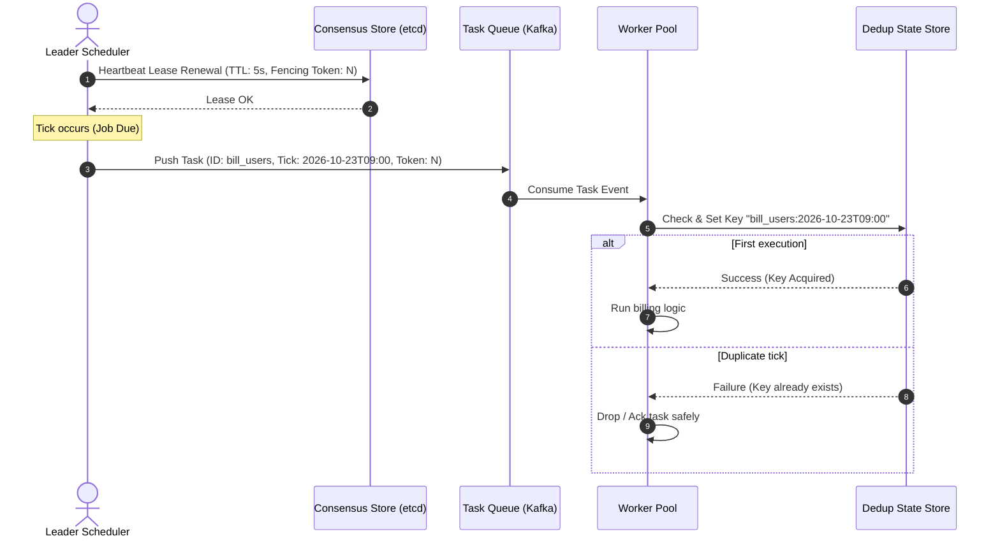

# Distributed Cron Service: Architecture & Interview Guide

This document explains the design principles, failure-handling mechanisms, clock synchronization challenges, and scaling strategies for distributed cron and job scheduling systems, referencing runnable implementations in the [`distributed_cron/`](https://github.com/termie/interviewprep-2026-10/tree/main/distributed_cron) directory.

GitHub Repository: [`termie/interviewprep-2026-10`](https://github.com/termie/interviewprep-2026-10)

---

## 1. Why Distributed Cron is Difficult

A standard single-machine cron (`crontab`) simply checks the local system clock every minute and forks a process. In a distributed, multi-datacenter production system, this breaks down:

1. **High Availability**: If the machine hosting the cron daemon dies, scheduled tasks stop executing entirely.
2. **Single-Execution Guarantee**: Multiple instances of a service must **never execute the same scheduled task simultaneously** (e.g., charging monthly credit cards or sending duplicate invoices).
3. **Clock Skew**: System clocks drift across physical machines (due to hardware oscillator variance and NTP step adjustments). A node running 2 seconds ahead could fire a tick early or multiple times.
4. **Decoupled Execution**: A long-running task (e.g., 20-minute DB backup) must not block subsequent cron ticks from triggering on time.

---

## 2. Core Architecture

```
+-----------------------------------------------------------------------------------+
|                           DISTRIBUTED SCHEDULER CLUSTER                           |
|                                                                                   |
|  +------------------------+                        +------------------------+     |
|  |     Leader Node 1      |                        |    Standby Node 2      |     |
|  |  (Holds active lease)  |                        |   (Watches heartbeat)  |     |
|  |                        |                        |                        |     |
|  |   [Min-Heap Schedule]  |                        |   [Min-Heap Schedule]  |     |
|  +------------------------+                        +------------------------+     |
|              |                                                 ^                  |
|              | Renew Lease (TTL=5s)                            | Failover Takeover|
|              v                                                 v                  |
|  +------------------------------------------------------------------------------+ |
|  |             Consensus / Coordination Store (etcd / Consul / Redis)            | |
|  |             Key: /cron/leader | Value: {node_1, fencing_token: 42}           | |
|  +------------------------------------------------------------------------------+ |
+-----------------------------------------------------------------------------------+
                                       |
                   Dispatches Tick Event: {task_id, tick_timestamp, fencing_token}
                                       v
                     +-----------------------------------+
                     |   Message Broker (Kafka / SQS)    |
                     +-----------------------------------+
                                       |
                     +-----------------+-----------------+
                     |                                   |
                     v                                   v
          +---------------------+             +---------------------+
          |  Worker Instance 1  |             |  Worker Instance 2  |
          | (Executes command)  |             | (Executes command)  |
          +---------------------+             +---------------------+
                     |                                   |
                     +-----------------+-----------------+
                                       v
          +---------------------------------------------------------+
          | Execution Dedup Store: Key = "task_id:2026-10-23T09:00" |
          +---------------------------------------------------------+
```



---

## 3. High-Level Architectural Approaches

| Approach | Scalability | Complexity | Failover Speed | Implementation |
| :--- | :--- | :--- | :--- | :--- |
| **Active-Passive Leader Lease** | Medium (~10k jobs) | Low to Medium | Instant (Lease TTL) | [`leader_lease_cron.py`](file:///home/termie/p/interviewprep-2026-10/distributed_cron/leader_lease_cron.py) |
| **Partitioned Consistent Hashing Ring** | **Very High (Millions of jobs)** | Medium to High | Sub-second (Local rebalance) | [`partitioned_ring_cron.py`](file:///home/termie/p/interviewprep-2026-10/distributed_cron/partitioned_ring_cron.py) |
| **Interview-Sized Heartbeat Cron** | Low to Medium | **Very Low (~70 lines)** | Immediate | [`interview_distributed_cron.py`](file:///home/termie/p/interviewprep-2026-10/distributed_cron/interview_distributed_cron.py) |
| **DB Polling (`SKIP LOCKED`)** | Low to Medium | Low (Leverages RDBMS) | High DB query load | Standard transactional table |

---

## 4. Key Interview Talking Points

### 1. Fencing Tokens & Zombie Leaders
* **The Problem**: Node A is leader. It suffers a 15-second Stop-The-World GC pause or network partition.
* Its lease expires in etcd. Node B is elected leader and begins dispatching ticks.
* Node A wakes up from GC and, unaware that it was demoted, attempts to dispatch the same tick.
* **The Solution**: Monotonically increasing **fencing tokens**. Every lease renewal/reelection increments the generation token. Downstream brokers or databases verify `token >= current_highest_token`. Messages from Node A carry an older token and are rejected immediately.

### 2. Execution Semantics: At-Least-Once vs. At-Most-Once
* **At-Least-Once (Recommended)**: Guarantee that every scheduled tick fires. In rare crash scenarios, a job might be dispatched twice. Workers **must be idempotent** using a deduplication key:
  $$\text{Dedup Key} = \text{job\_id} + \text{":"} + \text{scheduled\_tick\_timestamp}$$
* **At-Most-Once**: Tasks are marked executed *before* firing. If the worker crashes mid-run, the tick is lost forever. Only acceptable for non-critical metric flushes.

### 3. Misfire & Catch-Up Policies
If the scheduler cluster goes down for 30 minutes, how should it handle missed ticks when it recovers?
1. **Fire Once (Collapse)**: Run missed ticks once immediately and resume the normal schedule.
2. **Replay All (Catch-up)**: Sequentially replay all missed ticks (critical for financial accounting).
3. **Drop Missed**: Ignore missed ticks and wait for the next scheduled occurrence (typical for monitoring telemetry).

### 4. Horizontal Scale via Consistent Hashing
When scaling to millions of user-defined cron jobs, a single active leader's memory and CPU become the bottleneck.
* Partition jobs across nodes on a **Consistent Hash Ring** (`hash(job_id) -> Node`).
* Each node maintains an internal `heapq` / time wheel for only its assigned subset of jobs.
* When nodes enter or exit, virtual nodes ensure even distribution and minimize partition churn.

---

## 5. Implementations in this Workspace

### 1. Interview-Ready Distributed Cron ([`distributed_cron/interview_distributed_cron.py`](file:///home/termie/p/interviewprep-2026-10/distributed_cron/interview_distributed_cron.py))
* **Design**: Minimal (~70 lines) heartbeat lease store, min-heap priority queue, and active leader failover demonstration.
* **Best For**: Coding rounds and whiteboard interviews.

### 2. Active-Passive Leader Election with Fencing Tokens ([`distributed_cron/leader_lease_cron.py`](file:///home/termie/p/interviewprep-2026-10/distributed_cron/leader_lease_cron.py))
* **Design**: Consensus lease store, monotonically increasing fencing tokens to defeat zombie leaders, and worker deduplication key enforcement.
* **Best For**: Systems design questions involving consensus, failover, and execution guarantees.

### 3. Decentralized Partitioned Consistent Hash Ring ([`distributed_cron/partitioned_ring_cron.py`](file:///home/termie/p/interviewprep-2026-10/distributed_cron/partitioned_ring_cron.py))
* **Design**: Hash ring with virtual nodes for uniform partition distribution, horizontal multi-scheduler execution, and dynamic node join/leave rebalancing.
* **Best For**: Answering "How do you scale cron to 10 million scheduled jobs?".
