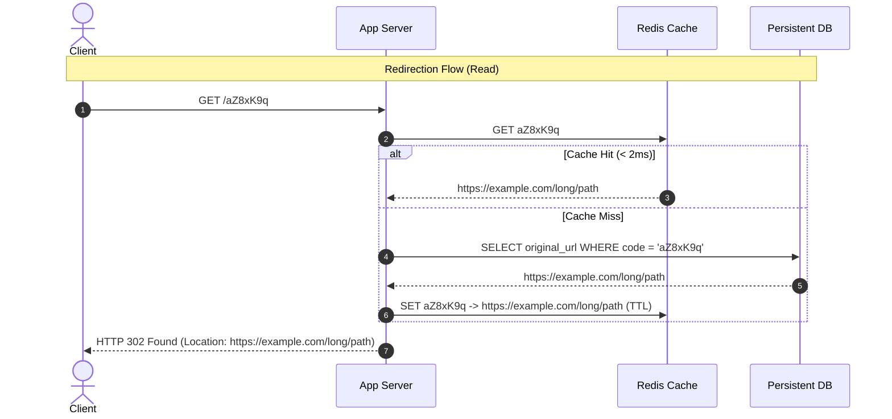

# URL Shortening Service: Architecture & Interview Guide

This document covers system design principles, capacity calculations, algorithm trade-offs, and failure handling for URL Shortening Services (e.g., TinyURL, Bitly), referencing runnable implementations in the [`url_shortener/`](https://github.com/termie/interviewprep-2026-10/tree/main/url_shortener) directory.

GitHub Repository: [`termie/interviewprep-2026-10`](https://github.com/termie/interviewprep-2026-10)

---

## 1. System Requirements & Capacity Estimations

### Functional Requirements
1. **Shorten**: Given a long URL, generate a unique, short alias (e.g., `https://sho.rt/aZ8xK9q`).
2. **Redirect**: Accessing a short URL redirects to the original destination with minimum latency.
3. **Custom Aliases**: Users can optionally pick custom aliases (e.g., `https://sho.rt/termie-resume`).
4. **Expiration (TTL)**: Links can optionally expire after a specified duration.

### Non-Functional Requirements
1. **Read-Heavy**: Read-to-write ratio is typically **100:1** (reads dominate writes).
2. **Low Latency**: Redirects must resolve in `< 15ms`.
3. **High Availability**: Redirection must not fail; eventual consistency is acceptable for analytics.
4. **Unpredictability**: Short URLs should not be easily sequential or guessable (to prevent web scraping and enumeration attacks).

### Back-of-the-Envelope Estimation
* **Write Traffic**: 100 million new URLs created per month $\approx 40$ writes/sec.
* **Read Traffic (100:1)**: $4,000$ redirects/sec.
* **Storage over 5 Years**:
  $$100\text{M} \times 12 \times 5 = 6 \text{ billion URLs}$$
  Assuming 500 bytes per record (original URL, short code, created_at, user_id):
  $$6 \times 10^9 \times 500 \text{ bytes} \approx 3 \text{ TB storage (5 years)}$$
* **URL Length Calculation**:
  Using Base62 characters (`[0-9, a-z, A-Z]` = 62 possibilities):
  * $62^6 \approx 56.8 \text{ billion unique URLs}$
  * $62^7 \approx 3.52 \text{ trillion unique URLs}$
  **Conclusion**: A **7-character** Base62 code easily satisfies the scale for decades.

---

## 2. Core Architecture

```
                                  +-------------------+
                                  |    DNS / CDN      |
                                  +-------------------+
                                            |
                                            v
                                  +-------------------+
                                  |   Load Balancer   |
                                  +-------------------+
                                            |
                         +------------------+------------------+
                         |                                     |
                         v                                     v
               +--------------------+                +--------------------+
               |    App Server 1    |                |    App Server 2    |
               | (Reads & Writes)   |                | (Reads & Writes)   |
               +--------------------+                +--------------------+
                   |            \                        /            |
                   |             \                      /             |
  (Writes: Range)  |              \ (Reads: Cache)     /              | (Writes: Range)
                   v               v                  v               v
        +--------------------+    +--------------------+    +--------------------+
        |  Range Coordinator |    | Distributed Cache  |    |  Database Cluster  |
        |  (ZooKeeper/etcd)  |    | (Redis LRU Cluster)|    | (PostgreSQL/NoSQL) |
        +--------------------+    +--------------------+    +--------------------+
```



---

## 3. Short Code Generation Strategies

| Strategy | Collision Risk | DB Contention | Predictability | Implementation |
| :--- | :--- | :--- | :--- | :--- |
| **Distributed Range Allocation (KGS)** | **Zero** | Very Low (Allocates in chunks) | Low (Can shuffle Base62) | [`base62_range_shortener.py`](file:///home/termie/p/interviewprep-2026-10/url_shortener/base62_range_shortener.py) |
| **Truncated Cryptographic Hash (SHA-256)** | High (Requires retry loop) | High (DB checks on collision) | Unpredictable | [`hash_collision_shortener.py`](file:///home/termie/p/interviewprep-2026-10/url_shortener/hash_collision_shortener.py) |
| **In-Memory Bijective Base62** | **Zero** | None (Single node) | Sequential | [`interview_url_shortener.py`](file:///home/termie/p/interviewprep-2026-10/url_shortener/interview_url_shortener.py) |
| **UUID / Random String** | Extremely Low | Low | Fully Random | Requires 10+ chars |

### Why Distributed Range Allocation (KGS) Wins
In distributed systems, querying a central database for auto-increment counters (`AUTO_INCREMENT`) creates a write bottleneck.
Using a **Range Coordinator** (e.g. ZooKeeper, etcd, or a sequence table):
1. Node A requests a lease: Coordinator grants `[1,000,000 to 1,999,999]`.
2. Node B requests a lease: Coordinator grants `[2,000,000 to 2,999,999]`.
3. Each node serves writes entirely in-memory using an atomic local counter without contacting the coordinator again until its block is 80% consumed.
4. If a node crashes, unallocated IDs in its chunk are lost (a negligible gap in a 3.5-trillion space), preserving absolute zero-collision guarantees.

---

## 4. Key Interview Talking Points

### HTTP 301 (Moved Permanently) vs. HTTP 302 / 307 (Found / Temporary Redirect)
* **HTTP 301**:
  * Browsers cache the redirection locally. Subsequent clicks never hit our servers.
  * **Benefit**: Saves server compute and bandwidth.
  * **Drawback**: You **cannot track click analytics** (geo, referrer, timestamps) or expire links early.
* **HTTP 302 / 307**:
  * Browsers do NOT cache permanently; every click hits our service.
  * **Benefit**: Accurate analytics, instantaneous link expiration, abuse inspection.
  * **Drawback**: Higher server load (mitigated by Redis caching).
* **Verdict**: Almost all production shorteners use **302 / 307** to collect analytics.

### Preventing Enumeration Attacks
Sequential numbers encoded into Base62 (`...0001`, `...0002`) allow attackers to easily crawl all links. Defenses:
1. **Alphabet Permutation**: Permute the Base62 characters randomly once across the cluster.
2. **Bit Shuffling (Feistel Cipher / Skip32)**: Apply a reversible bit-shuffle cipher to the integer ID before Base62 encoding so sequential integers yield scattered, random-looking Base62 strings.

### Cache Strategy & Eviction
* Cache 20% of the most active URLs using **LRU (Least Recently Used)** policy (Pareto Principle).
* At 4,000 read QPS, caching the top 20% easily achieves a >95% cache hit rate.

---

## 5. Implementations in this Workspace

### 1. Minimal Interview-Ready Shortener ([`url_shortener/interview_url_shortener.py`](file:///home/termie/p/interviewprep-2026-10/url_shortener/interview_url_shortener.py))
* **Design**: Concise Base62 encode/decode loop, custom alias collisions, and lazy TTL check (~60 lines).
* **Best For**: 45-minute live coding interviews.

### 2. Distributed Range-Allocated KGS ([`url_shortener/base62_range_shortener.py`](file:///home/termie/p/interviewprep-2026-10/url_shortener/base62_range_shortener.py))
* **Design**: Simulated ZooKeeper/etcd central range coordinator dispensing block leases to distributed worker nodes, Base62 encoding, and LRU cache-aside simulation.
* **Best For**: High-scale distributed systems questions.

### 3. Hash Truncation with Salting & Probing ([`url_shortener/hash_collision_shortener.py`](file:///home/termie/p/interviewprep-2026-10/url_shortener/hash_collision_shortener.py))
* **Design**: SHA-256 hash digest truncation, detecting database collisions, and salting/probing (`url:salt_1`) for collision resolution.
* **Best For**: Discussing trade-offs when interviewers suggest "just MD5/SHA256 the URL".
